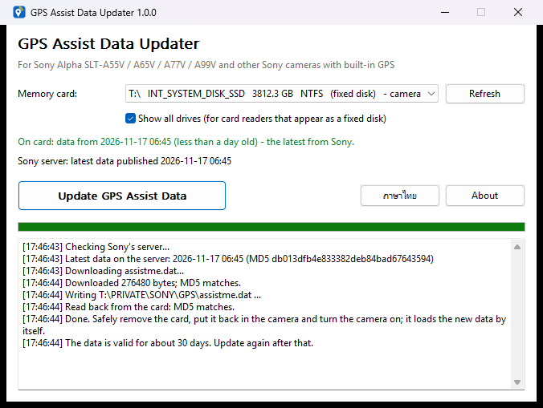
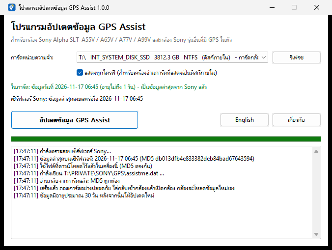

# GPS Assist Data Updater

Updates the GPS Assist Data on the memory card of Sony cameras with built-in GPS, so the camera finds
its position in seconds instead of minutes. One click downloads Sony's latest data, checks it and writes
it to the card. It replaces the GPS tool in Sony's old PC software.

English and Thai (ภาษาไทย) · x64, x86 (32-bit) and ARM64 · one small .exe, nothing to install



## Cameras

Sony cameras that read `\PRIVATE\SONY\GPS\assistme.dat` from the card, including the Alpha
**SLT-A55V, SLT-A65V, SLT-A77V and SLT-A99V**. Sony's own update instructions also cover its Cyber-shot
HX series, Action Cam HDR-AS / FDR-X series and Handycam HDR-TG / TD series models with GPS.

## Download

Get the latest version from [Releases](../../releases):

| File | For |
| --- | --- |
| `GpsAssistUpdater-<version>-x64.exe` | 64-bit Windows 10/11 (Intel/AMD) |
| `GpsAssistUpdater-<version>-x86.exe` | 32-bit Windows; also runs on any 64-bit Windows |
| `GpsAssistUpdater-<version>-arm64.exe` | Windows 11 on ARM (Snapdragon) |

No installation and no administrator rights are needed.

## How to use

1. Put the camera's memory card in the PC, or connect the camera by USB in Mass Storage mode.
2. Choose the card under **Memory card** and click **Update GPS Assist Data**.
3. Safely remove the card, put it back in the camera and turn the camera on. The camera loads the new
   data by itself.

The data is valid for about 30 days. The program shows how old the data on a card is, in green while
it is valid and in red once it has expired.

## How it works

- Downloads `assistme.dat` from Sony's server (`control.d-imaging.sony.co.jp/GPS/`), which publishes a
  new file every day, and checks it against the MD5 Sony publishes beside it.
- Writes it to `\PRIVATE\SONY\GPS\assistme.dat` through a temporary file, so an interrupted write never
  leaves a broken file, then reads it back from the card and checks the MD5 again.
- Skips the write if the card already has the latest data.
- Keeps the last download in `%LOCALAPPDATA%\GpsAssistUpdater`, so more cards can be updated, even
  offline, while that copy is under 30 days old.
- Lists only removable drives. **Show all drives** adds other disks for card readers that appear as a
  fixed disk, and the program asks before writing to one of them.
- English or Thai follows the Windows language; the language button switches it.

The data file comes from Sony's server each time and is not included in this repository.

| Thai |
| --- |
|  |

The screenshots come from a test run on a test drive. A real SD card shows as `(removable)` in the
list.

## Status

Tested against Sony's live server on Windows 11 with all three builds, including the offline and Thai
paths, writing to a test drive. It has not yet been confirmed on a real camera.

## Build

Needs Visual Studio 2022 or later with the C++ desktop workload (and the ARM64 tools for the ARM64
build). On an x64 or ARM64 PC run:

```text
build-all.cmd          rem all three into dist\
build.cmd x64          rem or one: x64, x86 or arm64
```

The builds use the static C runtime, so the exe needs only Windows' own DLLs. `make_icon.py` (Pillow)
regenerates the icon.

## Test

`test\run-test.ps1` drives the program by window messages and saves screenshots. Point it at a `subst`
drive, never a real card:

```powershell
subst T: C:\some\empty\folder
test\run-test.ps1 -Exe dist\GpsAssistUpdater-x64.exe -Drive T -Out shots -Cache C:\tmp\cache -Steps update,update-again,thai,about
subst T: /d
```

It refuses to click Update unless the selected drive is the one in `-Drive`. The environment variables
`GPSASSIST_SERVER` (for example `no-such-host.invalid` to test offline) and `GPSASSIST_CACHE` replace
the server name and the cache folder.

---

Not made by or affiliated with Sony. Sony, Alpha, Cyber-shot and Handycam are trademarks of Sony Group
Corporation.
